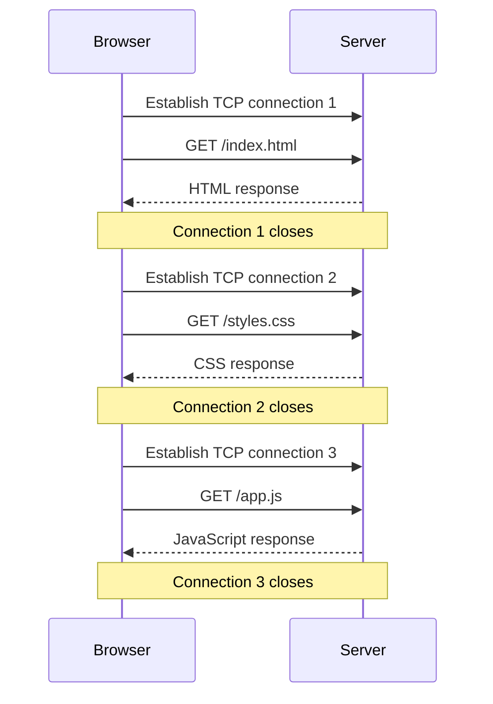
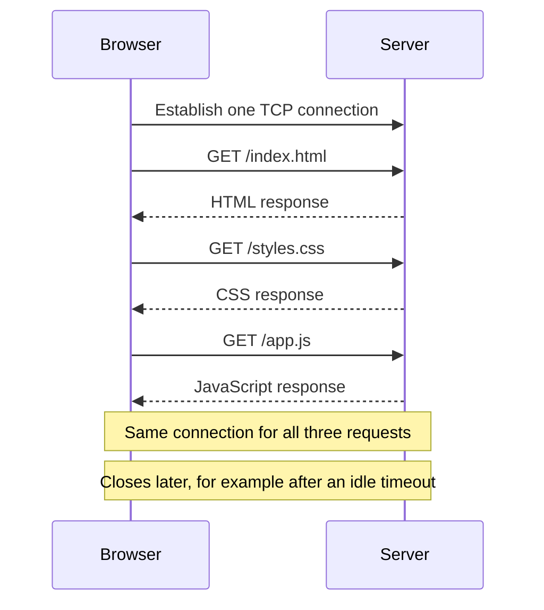
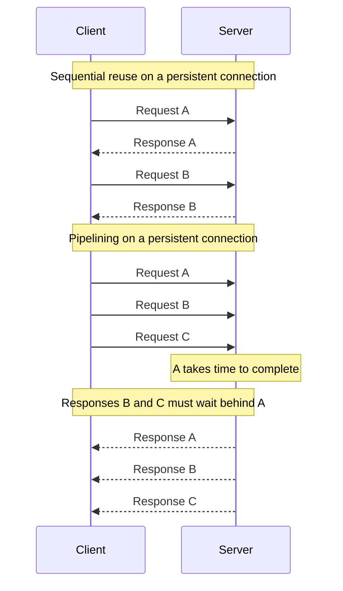
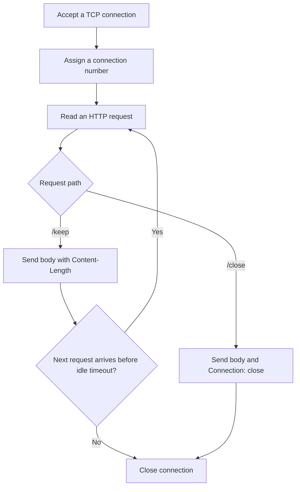

# Connection Management in HTTP/1.x

**Technical Deep-Dive** | Web Protocols | October 2026

Connection management controls when a client opens a connection, reuses it, and closes it.

Imagine opening a shopping website: the browser requests HTML, CSS, JavaScript, and product images. Each is an HTTP request. The question is: **does every request need a new TCP connection?**

This article focuses on HTTP/1.x over TCP. HTTPS adds TLS to that connection. For a closer look at the requests and responses themselves, start with [HTTP Message Structure](http-structure.md).

## 1. Short-lived connections

With the original HTTP/1.0 default, the client creates a connection for a request and closes it after the response.



This has two costs:

- **Repeated setup:** establishing TCP takes network exchanges before the HTTP request can be served.
- **Repeated warm-up:** new TCP connections must grow their sending rate; closing them repeatedly can prevent efficient use of available bandwidth.

## 2. Persistent connections: keep-alive

A persistent connection stays available for later requests.



The same shopping page can reuse an existing connection to fetch several resources.

| Version | Default | Relevant header |
| --- | --- | --- |
| HTTP/1.0 | Close after the response | Some implementations support reuse with `Connection: keep-alive`. |
| HTTP/1.1 | Reuse the connection | `Connection: close` requests closure after the current response. |

`Connection: keep-alive` enables persistence in supporting HTTP/1.0 implementations. The separate `Retry-After` response header indicates when a client should try again.

Persistence also depends on correctly identifying where each message ends. For example, a server can send `Content-Length`, allowing the client to read a complete body without waiting for the connection to close. The client must consume the response body before reusing that connection. See [RFC 9112, connection management](https://www.rfc-editor.org/rfc/rfc9112.html#section-9).

### An idle connection does not last forever

Keeping connections open uses sockets and memory. A server can apply idle timeouts and connection limits to balance reuse against resource consumption.

A response might advertise:

```http
HTTP/1.1 200 OK
Content-Length: 5
Connection: keep-alive
Keep-Alive: timeout=5

Hello
```

Here, `Connection` controls the connection option; `Keep-Alive` supplies parameters. Treat the timeout as information about connection management, not a guarantee against disconnection. See the [Keep-Alive header reference](https://developer.mozilla.org/en-US/docs/Web/HTTP/Reference/Headers/Keep-Alive).

**Design lesson:** under load, tune idle timeouts and connection limits. Closing every connection immediately is not automatically faster.

## 3. HTTP pipelining

Ordinary sequential reuse waits for one response before sending the next request. Pipelining sends several requests on one connection before their responses arrive.



HTTP/1.1 responses must remain in request order. If A is slow, B and C cannot overtake its response: this is **HTTP head-of-line blocking**.

Retries complicate pipelining. An idempotent operation can be repeated without an additional intended effect: setting a resource to the same value with PUT is different from creating another payment with POST. Idempotent does not mean read-only. Clients must consider method semantics and uncertain outcomes before retrying requests. See [RFC 9112, pipelining](https://www.rfc-editor.org/rfc/rfc9112.html#section-9.3.2).

Modern browsers do not enable HTTP/1.1 pipelining by default. **Persistence and pipelining are separate features:** observing connection reuse does not prove that requests were pipelined. See [MDN's pipelining discussion](https://developer.mozilla.org/en-US/docs/Web/HTTP/Guides/Connection_management_in_HTTP_1.x#http_pipelining).

## 4. Experiment: watch a connection being reused

This small Python server labels each accepted TCP connection. It exposes two paths:

| Path | Behavior |
| --- | --- |
| `/keep` | Leaves the connection available for the next request. |
| `/close` | Sends `Connection: close` and closes after the response. |

The server labels the TCP connection when it is accepted, then handles requests on that connection until it closes:



### Step A: start the server

Create `connection-demo.py` in a folder of your choice with this code. It uses Python's standard library.

```python
from http.server import BaseHTTPRequestHandler, ThreadingHTTPServer
from itertools import count

connection_numbers = count(1)


class Handler(BaseHTTPRequestHandler):
    protocol_version = "HTTP/1.1"

    def setup(self):
        super().setup()
        # setup() runs once per accepted connection, not once per request.
        self.connection_number = next(connection_numbers)
        self.connection.settimeout(5)

    def do_GET(self):
        path = self.path.split("?", 1)[0]
        should_close = path == "/close"
        body = (
            f"path={path}, connection={self.connection_number}\n"
        ).encode("utf-8")

        self.send_response(200)
        self.send_header("Content-Type", "text/plain; charset=utf-8")
        # A client needs to know where the body ends to reuse the connection.
        self.send_header("Content-Length", str(len(body)))
        self.send_header("Cache-Control", "no-store")
        if should_close:
            self.send_header("Connection", "close")
        self.end_headers()
        self.wfile.write(body)
        self.wfile.flush()
        self.close_connection = should_close

        print(body.decode("utf-8").strip(), flush=True)


if __name__ == "__main__":
    with ThreadingHTTPServer(("127.0.0.1", 8000), Handler) as server:
        print("Open http://127.0.0.1:8000/keep", flush=True)
        server.serve_forever()
```

From PowerShell in the folder containing `connection-demo.py`:

```powershell
python .\connection-demo.py
```

Keep that terminal open. Stop the server with **Ctrl+C** when finished.

The protocol version and accurate body length make this demo suitable for persistence. The socket timeout ends idle connections after roughly five seconds. This is a local learning server. See the [Python HTTP server documentation](https://docs.python.org/3/library/http.server.html).

### Step B: compare two requests with curl

Open a second PowerShell terminal.

**Reuse the connection:**

```powershell
curl.exe --http1.1 --noproxy "*" -v "http://127.0.0.1:8000/keep" "http://127.0.0.1:8000/keep"
```

Example response bodies:

```text
path=/keep, connection=1
path=/keep, connection=1
```

**Close after each response:**

```powershell
curl.exe --http1.1 --noproxy "*" -v "http://127.0.0.1:8000/close" "http://127.0.0.1:8000/close"
```

Example response bodies:

```text
path=/close, connection=2
path=/close, connection=3
```

The exact numbers depend on earlier requests. Compare whether they match.

- `--http1.1` selects the protocol under discussion.
- `--noproxy "*"` bypasses configured proxies for this local experiment.
- `-v` displays connection and header details.
- Both URLs are in **one invocation**, allowing curl to reuse its connection. Two separate curl processes do not share this connection.

This demonstrates sequential reuse, not pipelining. See the [curl manual](https://curl.se/docs/manpage.html).

### Step C: inspect the same behavior in a browser

In Chrome or Edge:

1. Open `http://127.0.0.1:8000/keep`.
2. Press **F12**, then select **Network**.
3. Right-click the request-table column headings. Enable **Protocol** and **Connection ID**.
4. Open the **Console** tab and run the following code:

```javascript
async function compareConnections(path) {
  for (let i = 0; i < 3; i++) {
    const response = await fetch(path, { cache: "no-store" });
    // Read the whole body before starting the next request.
    console.log((await response.text()).trim());
  }
}

await compareConnections("/keep");
await compareConnections("/close");
```

#### Compare connection numbers in the Response tab

Return to **Network**. Select **Fetch/XHR** to focus on the six requests from the script, then:

1. Select the first `/keep` request.
2. Click **Response**, beside **Preview**, to view its response body.
3. Note the `connection` number, then select the other two `/keep` requests and compare their numbers.
4. Repeat for the three `/close` requests.

Example response bodies, shown in request order:

```text
path=/keep, connection=5
path=/keep, connection=5
path=/keep, connection=5

path=/close, connection=5
path=/close, connection=6
path=/close, connection=7
```

**The same number means the requests used the same TCP connection. Different numbers mean they used different TCP connections.** These numbers identify connections; they do not count requests.

The first `/close` request can reuse the connection previously used by `/keep`. Its response then closes that connection, so the next request needs a new one. The exact numbers will depend on earlier requests and whether a connection has already timed out.

| Observation | Meaning |
| --- | --- |
| Protocol is `http/1.1` | You are examining the intended protocol. |
| Repeated connection numbers for `/keep` | Requests reused a server connection. |
| Different connection numbers for `/close` | Each response caused that connection to close. |
| Same browser Connection ID across requests | Those requests used the same browser connection. |

The response body's `connection` number is assigned by the Python server. The **Connection ID** column is assigned by the browser. Compare values within each system; the server's number does not need to match the browser's ID.

#### Check the server's connection policy in Headers

Select a `/close` request, click **Headers**, and expand **Response headers**. The server sends:

```http
Connection: close
```

This tells the client that the server will close the connection after the response. A `/keep` response does not need `Connection: keep-alive`, because persistence is the HTTP/1.1 default.

**Request headers** show what the browser sent. **Response headers** show what the server returned. A browser's `Connection: keep-alive` request header does not override a server's `Connection: close` response.

Browsers manage their own connection pools, so they can choose another connection even when reuse is allowed. The server's response body makes that choice visible. Favicon requests may also appear; focus on the fetch requests.

Select a request and open **Timing**. A reused connection generally does not need another initial connection setup. Localhost has very low latency, so connection identity is better evidence here than a large timing difference.

**Disabling the browser cache does not clear its connection pool.** Caching response content and reusing connections are different mechanisms. Column and timing details are documented in [Chrome DevTools' Network reference](https://developer.chrome.com/docs/devtools/network/reference).


The experiment demonstrates the tradeoff directly: `/keep` allows multiple requests to share a TCP connection, while `/close` requires a new connection for each subsequent request. Connection identifiers make this behavior observable without relying on timing differences.


---

Continue exploring with [HTTP Message Structure](http-structure.md) and [QUIC: The Transport Protocol Behind HTTP/3](quic-deep-dive.md).
